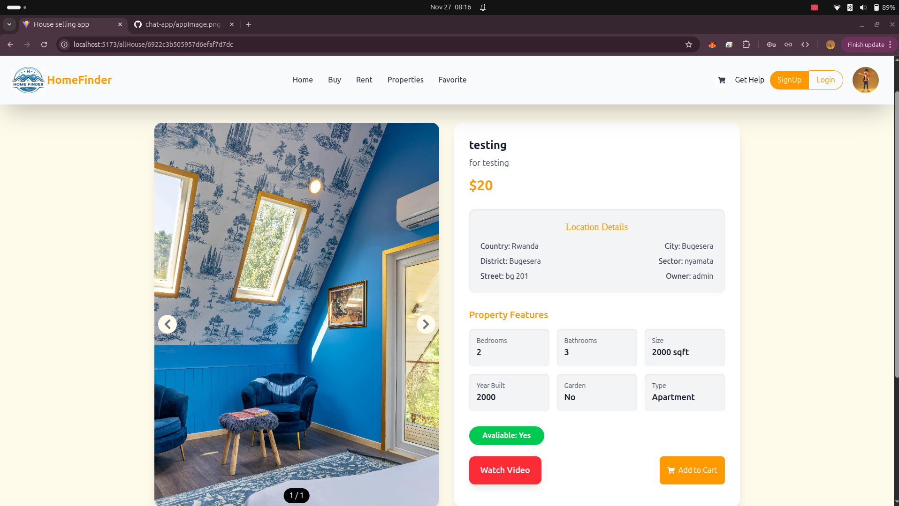

# 🏡 HomeFinder – Real Estate Platform

HomeFinder is a modern real estate web application designed to make finding, buying, and renting properties easier. It connects property owners and potential buyers or tenants through a simple, user-friendly platform.

Users can explore available properties, search for houses, view detailed property information, save their favorite listings, and manage their property interests in one place.

## 📸 Overview of the App



## ✨ Features

### 👤 User Authentication
- User registration and login.
- Secure password hashing.
- User profile management.
- Different user roles, including customers, sellers, and administrators.

### 🏠 Property Management
- Browse available properties.
- View properties for sale.
- Explore houses available for rent.
- View detailed property information.
- Add new property listings.
- Update and delete property listings.
- Upload property images and videos.
- View property location and specifications.

### 🔍 Property Search
- Search for properties.
- Find properties based on available listing information.
- View search results.

### ❤️ Favorites
- Like properties.
- Save interesting properties.
- View your favorite listings.

### 🛒 Shopping Cart
- Add properties to your cart.
- View properties added to your cart.
- Manage your selected properties.

### 📱 Responsive Design
- Mobile-friendly interface.
- Responsive layouts for tablets and desktop devices.
- Easy navigation across different screen sizes.

## 🛠️ Technologies Used

### Frontend
- React.js
- Vite
- Tailwind CSS
- Axios
- React Router DOM
- React Icons
- Framer Motion

### Backend
- Node.js
- Express.js
- MongoDB
- Mongoose
- Multer
- Bcrypt
- Express Session
- CORS
- Nodemailer

### Deployment
- Vercel – Frontend hosting
- Render – Backend hosting
- MongoDB Atlas – Cloud database

## 📂 Project Structure

```text
HomeFinder/
│
├── client/
│   ├── public/
│   ├── src/
│   │   ├── components/
│   │   ├── pages/
│   │   ├── assets/
│   │   ├── App.jsx
│   │   └── main.jsx
│   ├── package.json
│   └── vite.config.js
│
└── backend/
    ├── models/
    ├── routes/
    ├── controllers/
    ├── middleware/
    ├── uploads/
    ├── index.js
    ├── package.json
    └── .env
```

*Note: The structure above is illustrative. Adjust it to match the actual folders and files in your repository.*

## ⚙️ Installation and Setup

### 1. Clone the Repository

```bash
git clone https://github.com/niyomugaboetiene/house-sell-app.git
```

### 2. Navigate to the Project

```bash
cd house-sell-app
```

### 3. Setup the Backend

```bash
cd backend
npm install
```

Create a `.env` file inside the backend folder:

```env
PORT=5000
MONGO_URI=your_mongodb_atlas_connection_string
```

Add any other environment variables required by your application, such as session secrets and email credentials.

Start the backend:

```bash
npm start
```

### 4. Setup the Frontend

Open another terminal:

```bash
cd client
npm install
```

Create a `.env` file inside the client folder:

```env
VITE_BACKEND_URL=http://localhost:5000
```

Start the frontend:

```bash
npm run dev
```

Open the application in your browser using the local URL provided by Vite.

## 🔐 Environment Variables

| Variable | Description |
|---|---|
| `PORT` | Backend server port |
| `MONGO_URI` | MongoDB Atlas connection string |
| `VITE_BACKEND_URL` | Backend API URL for the frontend |

Keep sensitive credentials in environment variables. Never commit your `.env` files to GitHub.

## 🚀 Deployment

HomeFinder uses the following deployment services:

- **Frontend:** Vercel
- **Backend:** Render
- **Database:** MongoDB Atlas

For production, configure `VITE_BACKEND_URL` with your deployed Render backend URL and configure the required backend environment variables in Render.

## 🎯 Project Goals

HomeFinder aims to:

- Simplify the process of finding houses.
- Help property owners showcase their properties.
- Connect property sellers with potential customers.
- Make property discovery more accessible.
- Provide a convenient digital real estate experience.

## 👨‍💻 Developer

**Etiene Niyomugabo**

Student | Full-Stack Developer | Tech Enthusiast | AI Developer |

GitHub: [@niyomugaboetiene](https://github.com/niyomugaboetiene)

## 📄 License

This project is developed for educational and practical purposes. You can add an open-source license if you intend to allow others to reuse and distribute the code.